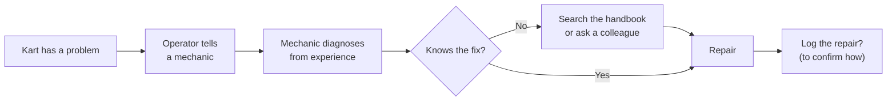
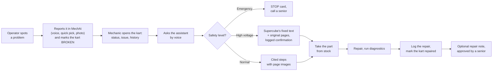

# Current Situation (As-Is) vs. Future (To-Be)

Back to [Analysis](Analysis.md)

## As-is: how it works today

> [!NOTE]
> Based on Senne's experience as a mechanic at Supercube. Points marked **To confirm** are checked in the interviews listed in [User & Stakeholder Analysis](User%20&%20Stakeholder%20Analysis.md).

| Area | Today | Pain |
| --- | --- | --- |
| Finding repair information | The manufacturer's handbook (English, 89 pages). Mechanics leaf through it, ask a colleague or work from memory. | Slow, not searchable in the mechanic's language, knowledge lost when people leave |
| Safety (high voltage) | Depends on the mechanic knowing the procedure. **To confirm:** whether Supercube has a written procedure. | Risk of a skipped step |
| Kart status | Kept in Supercube's own system and changed in the operator app. | Status is not linked to what was repaired |
| Reporting a problem | The operator notices a problem on the floor and tells a mechanic, or sends a chat message. **To confirm.** | Details get lost; no photo; no record per kart |
| Service history | **To confirm:** paper, a spreadsheet, a chat group, or nothing. | No overview of what was already done to a kart |
| Parts stock | **To confirm:** how stock is counted and ordered. | A part runs out unnoticed and the kart waits |
| To-dos | **To confirm:** spoken or in a chat message. | Tasks get forgotten between shifts |
| Experience | In people's heads. | The same fault is solved from scratch each time |

## To-be: how it works with MechAi

| Area | With MechAi | Benefit |
| --- | --- | --- |
| Finding repair information | Pick the kart, ask out loud in Dutch, French or English, get numbered steps with the handbook page cited and the page image shown. | Seconds instead of minutes; the source can always be checked |
| Safety | Three safety levels in code. Emergencies get a STOP card with no AI. High-voltage work shows Supercube's fixed text and the original pages, with a logged confirmation. Every number is checked against the cited page. | Safe by design, not by memory |
| Kart status | Mechanics mark a kart broken or repaired and run diagnostics from MechAi; the change goes to Supercube's system. | One place for status and repairs |
| Reporting a problem | The operator taps the kart, picks a quick reason or says it out loud, adds a photo and marks the kart broken. | Nothing gets lost; the mechanic sees exactly what was reported |
| Service history | Every repair, issue and photo is logged on the kart's page (date, who, parts, photos). | Full history for every kart |
| Parts stock | Parts list with stock and shelf; taking a part lowers the stock. | Fewer surprises; low-stock alerts |
| To-dos and notifications | Tasks per kart; notifications for unsafe issues, notes to approve and low stock. | Nothing gets lost between shifts |
| Experience | Repair notes, approved by a senior mechanic, become a searchable source. | The team's knowledge grows over time |
| Where is the part? | Exploded drawings from the handbook now; a 3D exploded view in semester 2. | Faster to locate parts, useful for new mechanics |

## Process flow

### As-is

### To-be

## Demo scenario (December prototype)

The demo follows one complete story on kart 07. The same flow works for every kart in the fleet.

> [!NOTE]
> This is the full future flow. The December demo is a shorter version, described in [Planning & Deadlines](../01%20Project/Planning%20&%20Deadlines.md): photos and the real Supercube connection are stretch goals there.

1. The operator notices that kart 07 pulls to one side and makes a grinding noise. They tap kart 07, pick "Noise" and "Wheel", say a short sentence, add a photo and mark the kart **BROKEN**.
2. A mechanic opens kart 07 and sees the issue, the photo and the history.
3. The mechanic asks out loud in Dutch: "Achterwiel heeft speling en maakt een schurend geluid."
4. The assistant answers with numbered steps from the handbook, each step citing its page, with the page images shown. A test question about the battery shows the high-voltage level instead of AI steps.
5. The mechanic takes the part from stock, does the repair and runs diagnostics.
6. The mechanic logs the repair, marks the kart repaired, and rates the answer. The test-set scores are shown at the end.

> [!NOTE]
> The demo uses the real handbook pages (for example section 5.3, pages 38-42, and section 5.6.2, page 48). Kart 07, the stock numbers and the history entries are example data.
