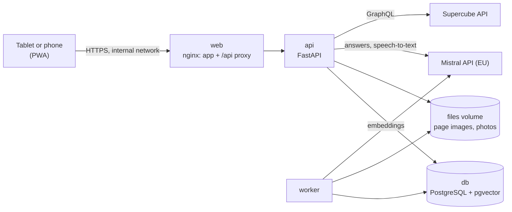

# Technical Analysis (RAG, LLM & stack)

Back to [Analysis](Analysis.md)

This note sums up the technical choices and the options that were compared. The background for each choice is in [RAG and AI](../04%20RAG%20and%20AI/RAG%20and%20AI.md), the build details are in [Architecture](../03%20Architecture/Architecture.md), and every decision is recorded in the [Decision Log](../10%20Decision%20Log/Decision%20Log.md).

> [!NOTE]
> **How RAG works here, in plain words.**
> 1. The handbook is cut into small pieces called **chunks**.
> 2. Each chunk is turned into an **embedding**: a list of numbers that represents its meaning, so texts with a similar meaning get similar numbers.
> 3. When a mechanic asks a question, the question gets an embedding too. The database finds the closest chunks (**vector search**) and also runs a classic word search for exact part numbers and codes. Combining both is called **hybrid search**.
> 4. The best sections go to the **LLM** (large language model, the model that writes text) with the instruction: answer only from these sources and cite them.
> 5. Code checks the answer before the mechanic sees it.

## Decisions at a glance

| Layer | Choice | Decision |
| --- | --- | --- |
| Architecture | Modular monolith: one backend, one worker, one PostgreSQL database | [ADR-1 Modular monolith- one backend + one worker + one PostgreSQL, no microservices](../10%20Decision%20Log/ADR-1%20Modular%20monolith-%20one%20backend%20+%20one%20worker%20+%20one%20PostgreSQL,%20no%20microservices.md) |
| Hosting | Docker Compose on Supercube's own server, internal network only | [ADR-24 Self-hosted on Supercube's servers with Docker Compose, reachable only on the internal network](../10%20Decision%20Log/ADR-24%20Self-hosted%20on%20Supercube's%20servers%20with%20Docker%20Compose,%20reachable%20only%20on%20the%20internal%20network.md) |
| Backend | Python 3.12, FastAPI, SQLAlchemy 2, Alembic | [ADR-7 Backend- Python 3.12, FastAPI, SQLAlchemy 2, Alembic](../10%20Decision%20Log/ADR-7%20Backend-%20Python%203.12,%20FastAPI,%20SQLAlchemy%202,%20Alembic.md) |
| Frontend | PWA with React, TypeScript and Vite | [ADR-8 Frontend- React + TypeScript + Vite PWA, three.js for the 3D exploded view](../10%20Decision%20Log/ADR-8%20Frontend-%20React%20+%20TypeScript%20+%20Vite%20PWA,%20three.js%20for%20the%203D%20exploded%20view.md), [ADR-18 The frontend is a PWA](../10%20Decision%20Log/ADR-18%20The%20frontend%20is%20a%20PWA.md) |
| Answer model, embeddings, speech-to-text | Mistral API: Mistral Small, `mistral-embed`, Voxtral speech-to-text | [ADR-38 Mistral API for answers, embeddings and speech-to-text](../10%20Decision%20Log/ADR-38%20Mistral%20API%20for%20answers,%20embeddings%20and%20speech-to-text.md) |
| Vector store and search | PostgreSQL with pgvector, hybrid search with RRF | [ADR-4 PostgreSQL + pgvector with hybrid search (RRF)](../10%20Decision%20Log/ADR-4%20PostgreSQL%20+%20pgvector%20with%20hybrid%20search%20%28RRF%29.md) |
| Parsing | Docling, without OCR (the PDF has real text) | [ADR-17 Docling for parsing and OCR](../10%20Decision%20Log/ADR-17%20Docling%20for%20parsing%20and%20OCR.md) |
| Retrieval | Baseline first, with English query translation; extra steps only if the tests improve | [ADR-27 Baseline-first retrieval with English query translation](../10%20Decision%20Log/ADR-27%20Baseline-first%20retrieval%20with%20English%20query%20translation.md), [ADR-22 Relevance check also ranks, cross-references are followed, one retry before refusing](../10%20Decision%20Log/ADR-22%20Relevance%20check%20also%20ranks,%20cross-references%20are%20followed,%20one%20retry%20before%20refusing.md) |
| RAG code | Plain Python with the Mistral SDK; LangChain and LangGraph stay open as options | [ADR-6 Plain Python + provider SDK for the full build (LangChain only in the starter)](../10%20Decision%20Log/ADR-6%20Plain%20Python%20+%20provider%20SDK%20for%20the%20full%20build%20%28LangChain%20only%20in%20the%20starter%29.md) |
| Login | Profile picker and personal PIN, four roles | [ADR-12 No accounts- profile picker + personal PIN, 30-minute idle logout](../10%20Decision%20Log/ADR-12%20No%20accounts-%20profile%20picker%20+%20personal%20PIN,%2030-minute%20idle%20logout.md), [ADR-26 Four roles- operator, mechanic, senior mechanic, admin](../10%20Decision%20Log/ADR-26%20Four%20roles-%20operator,%20mechanic,%20senior%20mechanic,%20admin.md) |
| Supercube system | REST for our API; one `supercube` module talks to Supercube's GraphQL API | [ADR-23 Keep REST for our own API, talk to Supercube's GraphQL API through one adapter module](../10%20Decision%20Log/ADR-23%20Keep%20REST%20for%20our%20own%20API,%20talk%20to%20Supercube's%20GraphQL%20API%20through%20one%20adapter%20module.md) |
| Safety | Three safety levels enforced in code | [ADR-30 Safety levels enforced in code](../10%20Decision%20Log/ADR-30%20Safety%20levels%20enforced%20in%20code.md) |
| Files | A Docker volume behind one `storage` module | [ADR-28 Files on a Docker volume behind one storage module](../10%20Decision%20Log/ADR-28%20Files%20on%20a%20Docker%20volume%20behind%20one%20storage%20module.md) |
| CI | GitHub Actions; images to the GitHub container registry | [Deployment and CI-CD](../05%20Features/Deployment%20and%20CI-CD.md) |

## Answer model options

| Option | Notes | Verdict |
| --- | --- | --- |
| **Mistral API, Mistral Small (chosen)** | French company, EU hosting; follows rules and writes structured JSON; multilingual; also offers embeddings and speech-to-text; about $0.15 / $0.60 per million tokens. Data terms checked before go-live. | Chosen on 17 November 2026. The model name lives in config, so it can change without code changes |
| DeepSeek | Strong and very cheap for chat | No embeddings or speech-to-text in its API; hosted API stores data in China. To be tested later on the test set |
| OpenAI API, small chat model | Good at rules and JSON; one provider for all three jobs | Chosen on 6 November 2026, dropped on 17 November 2026 |
| Supercube's own AI account | Unknown whether Supercube has one | If Supercube prefers it, only the `LLMClient` configuration changes |
| Azure OpenAI | Same models, hosted by Microsoft | Dropped on 6 November 2026 together with Azure hosting |
| Claude (Anthropic API) | Very good at citing and following rules | Was the choice on 6 October 2026; replaced to keep one provider for answers and embeddings |
| Local model (for example with Ollama) | Free, but needs a strong GPU on the server and is weaker on small GPUs | Dropped on 6 October 2026 |

## Vector database options

| Option | Pros | Cons | Verdict |
| --- | --- | --- | --- |
| **PostgreSQL + pgvector (chosen)** | One database for karts, stock, tasks and vectors; built-in full-text search for hybrid search; one backup | Index tuning by hand | Chosen: simplest to run and explain |
| A second database only for the assistant | Clear split | Two databases to run, back up and keep in sync; no joins between answers and karts | Rejected on 6 November 2026 |
| Chroma | Very easy for a quick test | A second database; weak hosting story | Only used in the old LangChain starter |
| Qdrant, Weaviate, Pinecone | Purpose-built and fast | Extra service; not needed for one handbook | Not needed at our size |

**How search works:** pgvector with an **HNSW index** (a structure that makes vector search fast) finds chunks by meaning. PostgreSQL full-text search finds exact words such as part numbers or failure codes. **RRF** (reciprocal rank fusion) merges both ranked lists into one.

## Embedding model options

| Option | Notes | Verdict |
| --- | --- | --- |
| **Mistral `mistral-embed` (chosen)** | 1,024 numbers per text, multilingual, $0.10 per million tokens (the whole handbook costs under a cent) | Chosen on 17 November 2026; the test set checks the quality |
| OpenAI `text-embedding-3-small` | 1,536 numbers per text, very cheap | Chosen on 6 November 2026, dropped with OpenAI on 17 November 2026 |
| BGE-M3 (local, open source) | Strong multilingual model, but needs our own machine | Dropped on 10 October 2026 |

**Updating the knowledge does not mean starting over.** Each chunk stores a content hash (a fingerprint of its text). When a new handbook revision or a new document arrives, only new or changed chunks get new embeddings. Karts and parts are normal database rows and are never embedded. Only a change of embedding model would mean embedding everything again, which for one handbook takes minutes and costs less than a cent.

## Knowledge sources

| Source | State | How we use it |
| --- | --- | --- |
| OTL Storm handbook | Digital PDF, English, 89 pages (rev 12 or V13, **to confirm**) | Parsed with Docling, split by section, every page rendered as an image for the chat |
| Wiring diagrams | Handbook pages 81-89 | Shown as page images for electrical questions; their captions and nearby text are searchable. The AI never writes wiring facts itself |
| Controller failure codes | Handbook section 6.2.1, pages 55-56 | Found by exact word search |
| Supercube's safety procedures | **To confirm**, written or approved by Supercube | Shown word for word at the high-voltage and emergency levels |
| Supercube's own AR parts (headset, steering-wheel PC, network switch) | Not in the handbook; **to confirm** whether documentation exists | Photos and short notes, only if needed |
| Repair notes | Created in MechAi | Searchable only after senior approval; rank below the handbook; never the source of a safety step |
| Issues, history, stock | Created in MechAi | Normal database data; not searched by the assistant in the prototype |

**Permission:** the handbook belongs to OTL Italia. Supercube must agree in writing that MechAi may use it and send its text to the Mistral API ([Questions for Supercube](../01%20Project/Questions%20for%20Supercube.md)). The handbook never goes into git or anywhere public.

Every chunk stores its metadata: document, revision, section number, heading, page range and language. Code builds the citation from this metadata, so the model never types a page number itself.

## Architecture in short

A **modular monolith**: one backend program with strict modules inside, plus one background worker and one PostgreSQL database. No microservices, message broker or API gateway. For two people, microservices would mean several deployments and databases for no gain.

The modules are `auth`, `fleet`, `issues`, `inventory`, `tasks`, `knowledge`, `assistant`, `supercube` and `storage`. See [Architecture](../03%20Architecture/Architecture.md).

## Retrieval strategy

Build the simplest reliable pipeline first, measure it, and add one improvement at a time:

1. **Baseline:** translate the question into English search terms, hybrid search, take the full parent section, answer with citations, refuse below the threshold.
2. **Then** add the relevance check (score 0 to 3 and re-order), follow "see section X" cross-references, and allow one retry before refusing. Each is kept only if the test set improves.
3. **Then** a full query rewrite if short or vague questions still fail.

**Rejected:** HyDE (a made-up answer can steer the search with invented details), compressing the retrieved text (can cut out a safety warning), GraphRAG and agentic RAG (unpredictable, slow and hard to test for one handbook). See [Retrieval technique choice](../04%20RAG%20and%20AI/Retrieval%20technique%20choice.md).

## Safety by design

Every question gets a safety level in code. **Emergency:** a STOP card with Supercube's text, no AI. **High voltage:** Supercube's fixed text and the original pages, one logged confirmation, no AI-written steps. **Normal:** cited steps with a number check. The stricter level always wins. See [Safety rules](../04%20RAG%20and%20AI/Safety%20rules.md).

## Evaluation plan

- **Test set:** 30 to 50 real questions, including at least 5 the handbook can't answer, 5 safety questions, 5 with part numbers or codes, and 5 each in Dutch and French.
- **Metrics:** recall@10 (is a correct page in the top 10?), MRR (how high is the first correct page?), citation accuracy, invented numbers, correct refusals, correct safety level.
- **Method:** change one thing at a time; save each run with the git commit; CI fails if recall drops. See [Evaluation](../04%20RAG%20and%20AI/Evaluation.md).

## Engineering practices

- Same layout for every module; automatic formatting and linting (ruff, Prettier, ESLint) through pre-commit and CI.
- One error format with module error codes ([Error handling](../03%20Architecture/Error%20handling.md)).
- One private GitHub repository for the code; a branch and pull request per feature, reviewed by the teammate; protected main branch.
- Conventional Commits and Semantic Versioning (v0.5.0 for the December prototype, v1.0.0 for the Showdown).
- Prompts, migrations and the test set live in git.

## Proof of concept so far

- **Clickable HTML prototype:** the official design reference, with the profile picker and PIN, the repair chat, kart pages, stock and a 3D exploded view sketch. See [HTML prototype (official)](../06%20Design%20and%20Prototypes/HTML%20prototype%20%28official%29.md).
- **Figma design:** screens and components; kept as design history. See [Figma Prototype](../06%20Design%20and%20Prototypes/Figma%20Prototype.md).
- **Handbook check:** the PDF has real text, clear section numbers and wiring diagrams on pages 81-89. Real pages for the demo were picked (sections 4.5.16, 5.3 and 5.6.2).
- **No measurements yet.** The first recall@10 on 15 questions comes in sprint 1.
