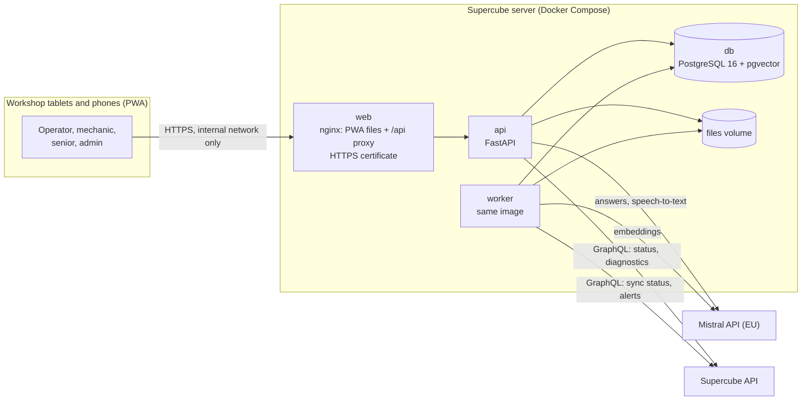

# Architecture

Back to [Final Work Hub](../Final%20Work%20Hub.md)

> [!IMPORTANT]
> **One modular backend, one worker, one database, on Supercube's own server.** This note is the build reference, as decided on 6 November 2026. Every choice links to its record in the [Decision Log](../10%20Decision%20Log/Decision%20Log.md).

## Key design choices

1. **Modular monolith.** One backend program with strict modules inside, plus one background worker and one PostgreSQL database. No microservices, message broker or API gateway. ([ADR-1 Modular monolith- one backend + one worker + one PostgreSQL, no microservices](../10%20Decision%20Log/ADR-1%20Modular%20monolith-%20one%20backend%20+%20one%20worker%20+%20one%20PostgreSQL,%20no%20microservices.md))
2. **Self-hosted with Docker Compose** on Supercube's server, reachable only on the internal network over HTTPS. Kubernetes files can be added if Supercube's IT uses Kubernetes. ([ADR-24 Self-hosted on Supercube's servers with Docker Compose, reachable only on the internal network](../10%20Decision%20Log/ADR-24%20Self-hosted%20on%20Supercube's%20servers%20with%20Docker%20Compose,%20reachable%20only%20on%20the%20internal%20network.md))
3. **The Mistral API** for answers, embeddings and speech-to-text, behind one `LLMClient` so the provider can change in one place. ([ADR-38 Mistral API for answers, embeddings and speech-to-text](../10%20Decision%20Log/ADR-38%20Mistral%20API%20for%20answers,%20embeddings%20and%20speech-to-text.md))
4. **Baseline-first retrieval.** Translate the question into English search terms, hybrid search, parent section, cited answer, refusal. Improvements are added one at a time and kept only when the test set improves. ([ADR-27 Baseline-first retrieval with English query translation](../10%20Decision%20Log/ADR-27%20Baseline-first%20retrieval%20with%20English%20query%20translation.md))
5. **Safety levels in code** decide what the AI may do. Emergencies and high-voltage work never get AI-written steps. ([ADR-30 Safety levels enforced in code](../10%20Decision%20Log/ADR-30%20Safety%20levels%20enforced%20in%20code.md))
6. **REST for our own API; one `supercube` module** talks to Supercube's GraphQL API to read kart status and to mark karts broken or repaired and run diagnostics. A fake client is used until access is granted. ([ADR-23 Keep REST for our own API, talk to Supercube's GraphQL API through one adapter module](../10%20Decision%20Log/ADR-23%20Keep%20REST%20for%20our%20own%20API,%20talk%20to%20Supercube's%20GraphQL%20API%20through%20one%20adapter%20module.md))
7. **Four roles** with a profile picker and personal PIN: operator, mechanic, senior mechanic, admin. ([ADR-26 Four roles- operator, mechanic, senior mechanic, admin](../10%20Decision%20Log/ADR-26%20Four%20roles-%20operator,%20mechanic,%20senior%20mechanic,%20admin.md))
8. **Files on a Docker volume** behind one `storage` module; the database stores only the path. ([ADR-28 Files on a Docker volume behind one storage module](../10%20Decision%20Log/ADR-28%20Files%20on%20a%20Docker%20volume%20behind%20one%20storage%20module.md))
9. **Incremental embeddings.** A content hash per chunk means only new or changed text is embedded again.
10. **Traces in our own PostgreSQL table** (question, sources, scores, prompt version, tokens, cost, answer, feedback). ([ADR-9 Store answer traces in our own Postgres table](../10%20Decision%20Log/ADR-9%20Store%20answer%20traces%20in%20our%20own%20Postgres%20table.md))
11. **One error format** with module error codes everywhere. ([ADR-32 One error format with module error codes](../10%20Decision%20Log/ADR-32%20One%20error%20format%20with%20module%20error%20codes.md), [Error handling](Error%20handling.md))
12. **API and worker share one container image** with a different start command: one build, one version number.
13. **A jobs table instead of a message broker.** The worker takes the next job with `FOR UPDATE SKIP LOCKED`; failed jobs are retried safely. ([ADR-36 Engineering safeguards- jobs, stock moves, document revisions, test set, Supercube checklist](../10%20Decision%20Log/ADR-36%20Engineering%20safeguards-%20jobs,%20stock%20moves,%20document%20revisions,%20test%20set,%20Supercube%20checklist.md))
14. **Simple, readable code with one module template**, enforced by formatters and linters. ([ADR-15 Simple, readable code with one copy-paste module template](../10%20Decision%20Log/ADR-15%20Simple,%20readable%20code%20with%20one%20copy-paste%20module%20template.md))

## System overview



## Modules

| Module | Responsibility | Owns (schema) | When |
| --- | --- | --- | --- |
| **core** | Database session, config, jobs queue, audit log, error handling, events | `core.jobs`, `core.audit_log` | Sprint 1 |
| **auth** | Profiles, roles, PIN login, sessions, idle logout | `auth.users`, `auth.sessions` | Sprint 1 |
| **storage** | Save, open and delete files on the volume (`save_file()`, `open_file()`); resizes photos | none (files only) | Sprint 1 |
| **knowledge** | Handbook ingestion (parse, chunk, embed, render pages), hybrid search, page images, approved notes as a source | `knowledge.documents`, `pages`, `sections`, `chunks` | Sprints 1-2 |
| **assistant** | Answer repair questions: safety level, translate, retrieve, answer, verify; traces and feedback; speech-to-text | `assistant.conversations`, `messages`, `traces`, `feedback` | Sprints 1-3 |
| **fleet** | Karts, status, service history, repair notes and their approval | `fleet.karts`, `service_events`, `repair_notes`, `kart_alerts`, `alert_codes` | Sprint 2 |
| **issues** | Kart problems reported by operators and mechanics, with photos and severity | `issues.issues`, `issue_photos` | Sprint 2 |
| **inventory** | Parts, shelves, stock movements | `inventory.parts`, `locations`, `stock_movements` | Sprint 3 |
| **supercube** | The only module that talks to Supercube's GraphQL API: `client.py`, `fake_client.py`, `service.py` (status, diagnostics, alerts) | `supercube.sync_state`, `supercube.actions` (log of status changes and diagnostics) | Sprint 3 (fake) |
| **tasks** | To-dos and notifications | `tasks.todos`, `notifications` | Semester 2 |

**Rules between modules:**

- A module only reads and writes its own schema. Other modules call its `service.py` functions, never its tables.
- Cross-module reactions use small in-process events. Examples: `IssueReported` with "kart unsafe" makes fleet mark the kart broken and tasks send an alert; `RepairNoteApproved` makes knowledge index the note; `StockBelowMinimum` makes tasks create a to-do.
- These borders are where the app could be split into services later, if ever needed.

## Module template (copy-paste for new features)

Every feature is built the same way: copy an existing module folder, rename it, change the code.

**Backend:** `backend/app/modules/<feature>/`

| File | What goes in it |
| --- | --- |
| `models.py` | The database tables of this module (SQLAlchemy) |
| `schemas.py` | The request and response shapes (Pydantic) |
| `service.py` | The logic. The only file other modules may call |
| `router.py` | The endpoints under `/api/v1/<feature>`; thin, it only calls `service.py` |
| `errors.py` | This module's error codes with their prefix (for example `INVENTORY_`) |
| `README.md` | What the module does, and the copy-and-rename steps |

**Frontend:** `frontend/src/features/<feature>/` with `api.ts`, `pages/` and `components/`.

**Shared code lives in one place only:** `backend/app/core/` and `frontend/src/components/ui/` (buttons, cards, quick-pick chips, the microphone button and the one camera component).

**Example, the issues module:**

```txt
backend/app/modules/issues/
├─ models.py     # Issue, IssuePhoto
├─ schemas.py    # IssueCreate, IssueOut, IssueUpdate
├─ service.py    # report_issue(), list_for_kart(), to_todo(), mark_fixed()
├─ router.py     # POST /issues, GET /issues?kart_id=, ...
├─ errors.py     # ISSUES_NOT_FOUND, ISSUES_TOO_MANY_PHOTOS, ...
└─ README.md
frontend/src/features/issues/
├─ api.ts
├─ pages/ReportIssuePage.tsx, IssueDetailPage.tsx
└─ components/IssueCard.tsx, ReasonPicker.tsx
```

**How to add a feature (for example "tyre checks"):**

1. Copy `backend/app/modules/issues/` to `backend/app/modules/tyre_checks/` and rename the classes and the error prefix.
2. Change `models.py`, then run `alembic revision --autogenerate -m "tyre checks"`.
3. Register the router in `main.py` (one line).
4. Copy `frontend/src/features/issues/` to `frontend/src/features/tyre-checks/` and change the screens.
5. Add the route and the menu item (one line each).

**Rules:** clear names, short functions, a comment only where the reason isn't obvious, no duplicated code, no abstractions "for later", no extra libraries without a reason. If a reviewer can't follow an endpoint from router to service to model in a minute, simplify it.

## Communication

- **Frontend to API:** REST and JSON over HTTPS under `/api/v1`. FastAPI generates the OpenAPI description; the frontend generates its TypeScript client from it. See [API design](API%20design.md).
- **API to worker:** through the `core.jobs` table. The API inserts a job; the worker polls every 2 seconds and takes one with `SELECT … FOR UPDATE SKIP LOCKED`.
- **Answers:** one request per question (target about 10 seconds). The interface shows progress steps ("Searching the handbook…", "Checking the sources…"). Streaming can come later.
- **Voice:** the app records audio, sends it to `POST /assistant/transcribe`, and shows the text so the mechanic can check it before sending.
- **Files:** uploads go through the `storage` module; photos are resized on the device and again on the server. Page images and photos are served only through the API after sign-in.
- **Supercube:** status changes and diagnostics go from the API to Supercube right away; the worker syncs status and alerts in the background. See [Supercube integration (GraphQL)](Supercube%20integration%20%28GraphQL%29.md).

## Security

- **Network:** MechAi is only reachable on Supercube's internal network, over HTTPS with a certificate from Supercube IT. No public URL.
- **Sign-in:** profile picker plus a personal PIN (4 to 6 digits), stored only as an Argon2 hash. 5 wrong tries lock the profile; PIN attempts are rate limited. The session lives in a Secure, HttpOnly, SameSite=Strict cookie and ends after 30 minutes without activity. See [Profile picker + PIN login and roles](../05%20Features/Profile%20picker%20+%20PIN%20login%20and%20roles.md).
- **Roles:** checked by the backend on every request, not only hidden in the interface. A test calls the API directly as the wrong role to prove it is blocked.
- **Approvals:** a senior mechanic re-enters the PIN to approve a repair note, so the approval is tied to the right person.
- **Audit:** status changes, diagnostics, approvals, stock changes and user changes go to `core.audit_log` with the person and time.
- **Secrets:** an `.env` file or Docker secrets on the server; never in code or git. Only `.env.example` is committed.
- **Application:** Pydantic validation, ORM-only SQL, upload type and size checks, rate limits per user (also a cost guard).
- **AI:** sources are passed as data, never as instructions; repair notes count only after approval; the output must match a JSON schema; every number and citation is checked in code.
- **Supply chain:** pinned dependencies, Dependabot, GitHub secret scanning, a container image scan (Trivy), small base images and a non-root container user.
- **Privacy:** only the handbook sections needed for one question go to Mistral; no handbook text in logs; traces stay in our own database on Supercube's server.

## Detailed build notes

- [RAG pipeline (build spec)](RAG%20pipeline%20%28build%20spec%29.md)
- [Data model](Data%20model.md)
- [API design](API%20design.md)
- [Supercube integration (GraphQL)](Supercube%20integration%20%28GraphQL%29.md)
- [Error handling](Error%20handling.md)
- [Hosting and deployment](Hosting%20and%20deployment.md)
- [Repo & dev setup](Repo%20&%20dev%20setup.md)
