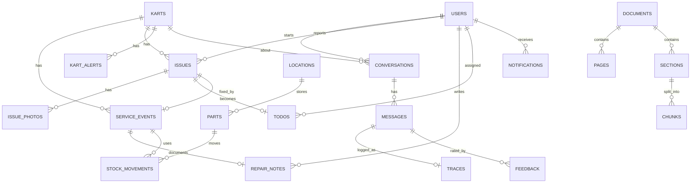

# Data model

Back to [Architecture](Architecture.md)

> [!NOTE]
> One PostgreSQL 16 database with pgvector, one schema per module ([ADR-4 PostgreSQL + pgvector with hybrid search (RRF)](../10%20Decision%20Log/ADR-4%20PostgreSQL%20+%20pgvector%20with%20hybrid%20search%20%28RRF%29.md)). Every table has `id` (UUID), `created_at` and `updated_at`. These columns are the starting point for the first Alembic migrations and will be adjusted once Supercube's real data (kart numbering, part numbers, existing history) is known.

## Entity relationships



## core

- **jobs:** type (`ingest_document`, `embed_note`, `sync_supercube`, …), payload (JSONB), status (`queued` / `running` / `done` / `failed`), attempts, last_error (error code and message), run_after, locked_until. A crashed job is picked up again after `locked_until`; after 3 attempts it stays `failed`.
- **audit_log:** user_id, action, entity, entity_id, details (JSONB), request_id.

## auth

- **users:** display_name, photo_path, role (`operator` / `mechanic` / `senior` / `admin`), pin_hash (Argon2), failed_pin_attempts, locked_until, language (`nl` / `fr` / `en`), active. No email or password: sign-in is profile plus PIN.
- **sessions:** user_id, created_at, last_activity_at, ended_at. A session ends after 30 minutes without activity.

## fleet

- **karts:** number (for example `07`, unique), kart_model, venue (default `brussels`), status (Supercube's values: `good` / `diagnostic` / `broken` / `permanently_broken`), supercube_pod_id (unique, empty until linked), photo_path. Whether someone is working on a kart is stored on the service event, not in the status.
- **service_events:** kart_id, user_id, type (`repair` / `service` / `inspection`), symptom, work_done, started_at, finished_at, conversation_id (the chat that helped).
- **repair_notes:** service_event_id, author_id, kart_model, symptom, cause, fix, parts_text, photo_paths, status (`draft` / `in_review` / `approved` / `rejected`), approved_by, approved_at, version. Editing an approved note sets it back to `in_review`.
- **kart_alerts:** kart_id, code, active, started_at, duration_s, source (`supercube`). Copied from Supercube's API by the worker.
- **alert_codes:** code, title, possible_causes, handbook_page. Entered once from handbook section 6.2.1 (pages 55-56) and checked by a senior mechanic, once Supercube confirms what its alert codes mean.

## issues

- **issues:** kart_id, reported_by, reason (`noise` / `steering` / `brakes` / `battery` / `damage` / `other`), description (typed or spoken), severity (`low` / `high` / `kart_unsafe`), status (`open` / `in_progress` / `fixed`), todo_id, fixed_by_event_id, fixed_at.
- **issue_photos:** issue_id, file_path, kind (`before` / `after`), taken_by, width, height.

The kart history is one query over `fleet.service_events`, `issues.issues` and `fleet.kart_alerts` for one kart, sorted by date. No data is copied.

## inventory

- **locations:** name (shelf or bin, for example `B3`), venue.
- **parts:** part_number (unique), name, description, location_id, quantity, minimum_quantity, handbook_ref, model_node (the part's name in the 3D model, semester 2).
- **stock_movements:** part_id, quantity_change (−1 when taking a part), reason (`repair` / `restock` / `correction`), service_event_id, user_id, request_id (unique, so a retry or double tap is not booked twice). A database check keeps `parts.quantity` at zero or more.

## knowledge

- **documents:** title, kart_model, language, source_type (`handbook` / `procedure` / `repair_note`), revision, published_on, superseded_by, file_path. The current revision of each document is the one with no `superseded_by`.
- **pages:** document_id, page_number, image_path (rendered PNG), text, kind (`text` / `diagram`).
- **sections:** document_id, section_number (for example `5.3`), heading_path, page_start, page_end, text, token_count, safety_level (`normal` / `high_voltage` / `emergency`).
- **chunks:** section_id, text (with a context header: document, section, heading), content_hash, token_count, embedding `vector(1024)`, tsv `tsvector` (English full-text search), embedding_model. A new revision reuses the embedding of any chunk whose `content_hash` and `embedding_model` already exist.

## assistant

- **conversations:** user_id, kart_id, title.
- **messages:** conversation_id, role (`user` / `assistant`), content, input (`typed` / `voice`), answer_json (JSONB).
- **traces:** message_id, safety_level, search_terms, retrieved (JSONB: chunk ids and scores), sections_sent, prompt_version, model, document_revisions, tokens_in, tokens_out, cost_eur, latency_ms (JSONB per step), flags (verification problems), error_code.
- **feedback:** message_id, user_id, rating (`up` / `down`), reason (`wrong_kart` / `wrong_page` / `wrong_step` / `unsafe` / `missing_step` / `other`), comment.

## supercube

- **sync_state:** last_sync_at, last_error.
- **actions:** kart_id, user_id, action (`mark_broken` / `mark_repaired` / `start_diagnostic` / `stop_diagnostic`), speed_mode (`PODLANE` / `CRUISE` / `BOOST` / `HIGH_BOOST` / `HIGH_BRAKE`), result (`ok` / error code), request_id.

## tasks (semester 2)

- **todos:** title, kart_id, part_id, issue_id, assigned_to, due_at, status, created_by (`user` / `system`).
- **notifications:** user_id, type (`issue_unsafe` / `note_to_review` / `low_stock` / `task_assigned`), payload, read_at.

## Key indexes for search

```sql
CREATE EXTENSION IF NOT EXISTS vector;

CREATE INDEX chunks_embedding_hnsw
  ON knowledge.chunks USING hnsw (embedding vector_cosine_ops);
CREATE INDEX chunks_tsv  ON knowledge.chunks USING gin (tsv);
CREATE INDEX chunks_hash ON knowledge.chunks (content_hash, embedding_model);

CREATE INDEX issues_by_kart ON issues.issues (kart_id, created_at DESC);

-- with a filter, let pgvector keep scanning so it still returns enough rows
SET hnsw.iterative_scan = relaxed_order;
```

The `pgvector/pgvector:pg16` Docker image already contains the extension.
