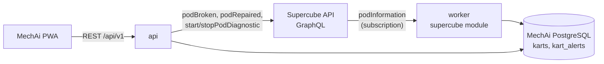

# Supercube integration (GraphQL)

Back to [Architecture](Architecture.md) · Related: [API design](API%20design.md) · [Data model](Data%20model.md) · [Supercube kart status and diagnostics](../05%20Features/Supercube%20kart%20status%20and%20diagnostics.md) · [ADR-23 Keep REST for our own API, talk to Supercube's GraphQL API through one adapter module](../10%20Decision%20Log/ADR-23%20Keep%20REST%20for%20our%20own%20API,%20talk%20to%20Supercube's%20GraphQL%20API%20through%20one%20adapter%20module.md)

> [!IMPORTANT]
> MechAi keeps **REST** for its own API. One module, `supercube`, is a **GraphQL client** of Supercube's existing API. It reads kart status and alerts, marks karts broken or repaired, and starts and stops diagnostics, the same way Supercube's operator app does. Until Supercube grants access, the module uses a fake client with demo data, so the prototype does not depend on it.

## GraphQL in plain words

- **REST** has many URLs, one per thing: `GET /fleet/karts/07` returns kart 07.
- **GraphQL** has one URL. The client sends a small query that lists exactly the fields it wants, and the server returns exactly those. A **schema** file (`.graphqls`) describes every type and field.
- A **query** reads data, a **mutation** changes data, and a **subscription** keeps a connection open (a WebSocket) so the server can push changes.

## What Supercube's schema offers

Supercube shared its schema (`base.graphqls` and `mechanic.graphqls`) on 6 November 2026. In Supercube's system a kart is called a **pod**.

| Kind | Name | What it does | Used by MechAi |
| --- | --- | --- | --- |
| Query | `podAlertsSummary(start, end)` | Fleet report for a date range: failed pods, and per alert code how often and how long | Semester 2 (admin overview) |
| Mutation | `podBroken(podId)` | Mark a pod broken | Yes: "Mark broken" |
| Mutation | `podPermanentlyBroken(podId)` | Mark a pod permanently broken | Admin only, semester 2 |
| Mutation | `podRepaired(podId)` | Mark a pod repaired | Yes: "Mark repaired" |
| Mutation | `startPodDiagnostic(podId, speedMode)` | Start diagnostics in a speed mode | Yes: Diagnostics |
| Mutation | `stopPodDiagnostic(podId)` | Stop diagnostics | Yes: Stop |
| Subscription | `podInformation` | Live list of all pods: status, connected, active alert codes | Yes: worker sync |
| Subscription | `podAlerts(podId, start, end)` | Alerts of one pod: code, active, start, duration | Semester 2 |
| Subscription | `podAlertsAggregated(podId, start, end)` | The same alerts per day | Semester 2 |
| Subscription | `dashboard` | Active pods out of total pods | Optional |

A pod has one of four statuses: `GOOD`, `DIAGNOSTIC`, `BROKEN`, `PERMANENTLY_BROKEN`. MechAi uses the same four values for its kart status.

The speed-mode enum in the schema is `SAFETY`, `SLOW`, `PODLANE`, `HIGH_BRAKE`, `CRUISE`, `BOOST`, `HIGH_BOOST`.

## How MechAi uses it

### Kart status

- **Mark broken:** operators and mechanics. MechAi calls `podBroken`, then saves the new status and an audit row.
- **Mark repaired:** mechanics, seniors and admins. MechAi calls `podRepaired`, usually at the end of logging a repair.
- **Sync:** the worker keeps one `podInformation` subscription open (or polls every minute if subscriptions are hard to reach) and copies status, `connected` and active alerts into our database. The tablets read everything from MechAi's REST API and never talk to Supercube directly or hold its credentials.

### Diagnostics

The flow copies Supercube's operator app, with three safety additions:

1. On a kart's page, tap **Diagnostics**. The kart enters diagnostics without a speed mode yet.
2. Choose one of five big buttons: **Pitlane**, **Cruise**, **Boost**, **High boost** or **High brake**. MechAi calls `startPodDiagnostic` with `PODLANE`, `CRUISE`, `BOOST`, `HIGH_BOOST` or `HIGH_BRAKE`.
3. Before the first mode starts, a full-screen check asks **"Nobody is at or under the kart"**. The person confirms with one big button; the confirmation is logged.
4. A large **Stop** button calls `stopPodDiagnostic`. Diagnostics also **stop automatically** after 60 seconds without a new command (value to confirm with Supercube).
5. Diagnostics are **blocked** while another person has an open repair on that kart. The screen names who is working on it.

There is no extra PIN: every signed-in role, operators included, can run diagnostics, the same as in the operator app. Every start, mode change and stop is written to `supercube.actions` and `core.audit_log` with the person and time. `SAFETY` and `SLOW` are not shown, because the operator app does not show them (**to confirm** with Supercube).

> [!WARNING]
> Diagnostics make a real kart move, and during a repair hands are near the chain and wheels. That is why MechAi adds the "nobody at the kart" check, the automatic stop and the block during an open repair. The real connection is only switched on after Supercube's written OK.

### Alerts and the repair assistant (semester 2)

- New alerts become rows in `fleet.kart_alerts` and show in the kart history next to issues and repairs.
- A small `alert_codes` table (code, title, possible causes, handbook page) is filled once Supercube confirms what the codes mean. If they are the controller failure codes from handbook section 6.2.1 (pages 55-56), tapping an alert opens the assistant with "What does failure 31 mean on kart 07?" and the answer cites those pages.



## Module layout

```txt
backend/app/modules/supercube/
├─ client.py        # the real GraphQL calls (gql library)
├─ fake_client.py   # demo pods, statuses and alerts for the prototype
├─ service.py       # mark_broken(), mark_repaired(), start_diagnostic(), stop_diagnostic(), sync()
├─ models.py        # sync_state, actions
├─ errors.py        # SUPERCUBE_UNREACHABLE, SUPERCUBE_REJECTED, SUPERCUBE_POD_UNKNOWN, ...
└─ README.md
```

A setting `SUPERCUBE_CLIENT=fake|real` picks the client. If Supercube's schema changes, only this module changes.

## Error handling

Supercube's mutations return `success: Boolean` with no reason. MechAi turns every failure into a clear error code:

| Situation | Code |
| --- | --- |
| No connection or timeout | `SUPERCUBE_UNREACHABLE` |
| The mutation returned `success: false` | `SUPERCUBE_REJECTED` |
| The kart has no linked pod id | `SUPERCUBE_POD_UNKNOWN` |
| Sign-in to Supercube failed | `SUPERCUBE_AUTH_FAILED` |

When marking a kart **broken** fails (for example Supercube's API is down), MechAi saves it locally as "broken, not synced", retries it as a background job, and shows a banner asking the person to also mark the kart broken in Supercube's operator app. An unsafe kart must never stay in play because a call failed. Other failed status changes leave the local status unchanged. See [Error handling](Error%20handling.md).

## Why not GraphQL for our own API

1. Our app is mostly simple forms and lists plus one assistant call; REST fits that and FastAPI gives validation, docs and a generated TypeScript client for free.
2. Photo uploads and audio uploads are awkward in GraphQL.
3. GraphQL needs resolvers, protection against heavy queries and per-field permission checks: more to learn and to get wrong for two people.
4. It goes against the rule to keep the code simple ([ADR-15 Simple, readable code with one copy-paste module template](../10%20Decision%20Log/ADR-15%20Simple,%20readable%20code%20with%20one%20copy-paste%20module%20template.md)).

If Supercube later wants a GraphQL API from MechAi, a GraphQL layer can call the same `service.py` functions next to the REST routes, without a rewrite.

## What MechAi adds to Supercube's data

Supercube's system knows *that* a pod went broken, but not *why*, *who* fixed it or *which part* was used. MechAi fills that gap with issues, photos, service events, stock movements and repair notes, all linked to the same pod id.

## Open questions

These are in [Questions for Supercube](../01%20Project/Questions%20for%20Supercube.md): API access and a test environment, how a server signs in, the WebSocket protocol, the meaning of the alert codes, how a pod id maps to the kart number, and whether times are UTC.
