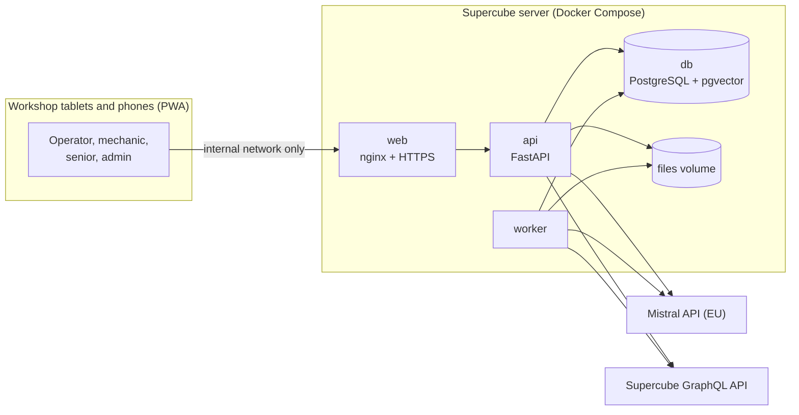
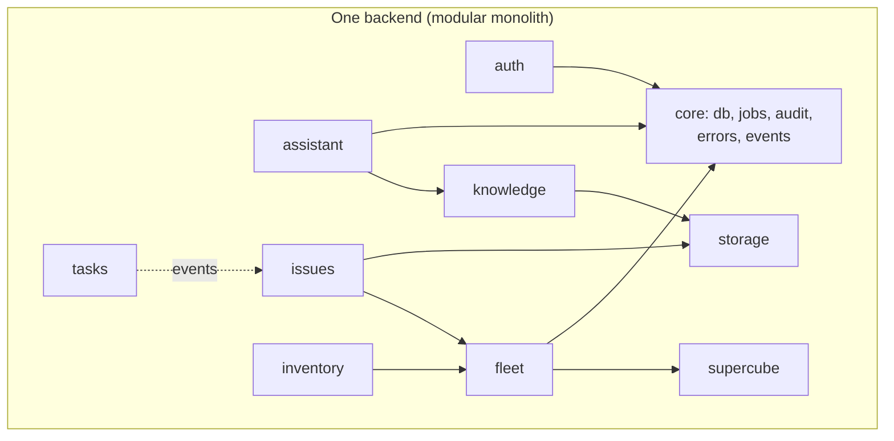
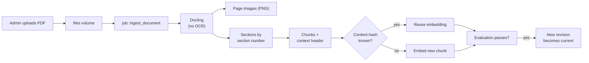
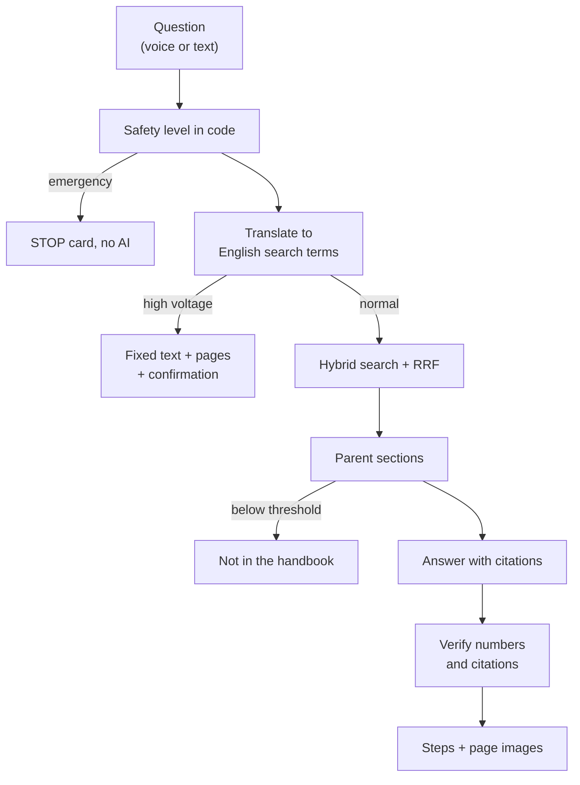
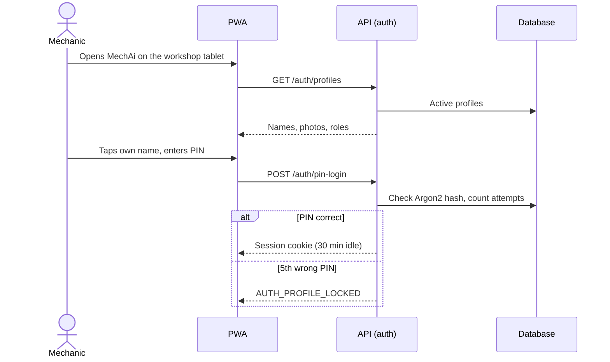
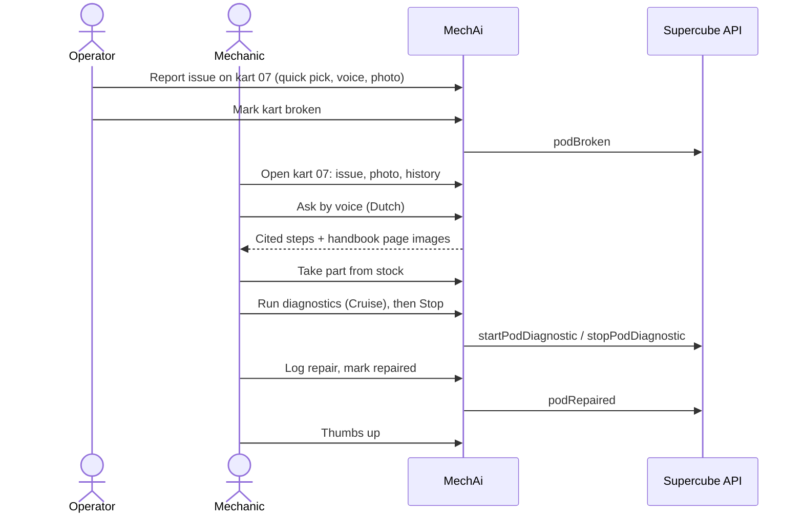
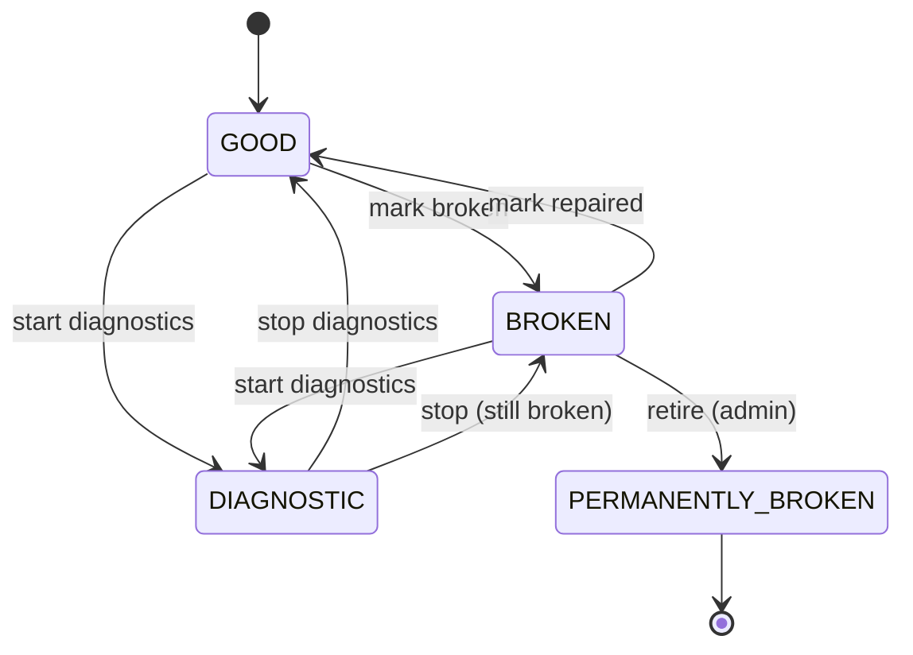
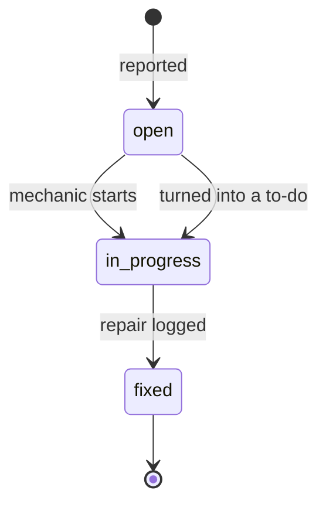
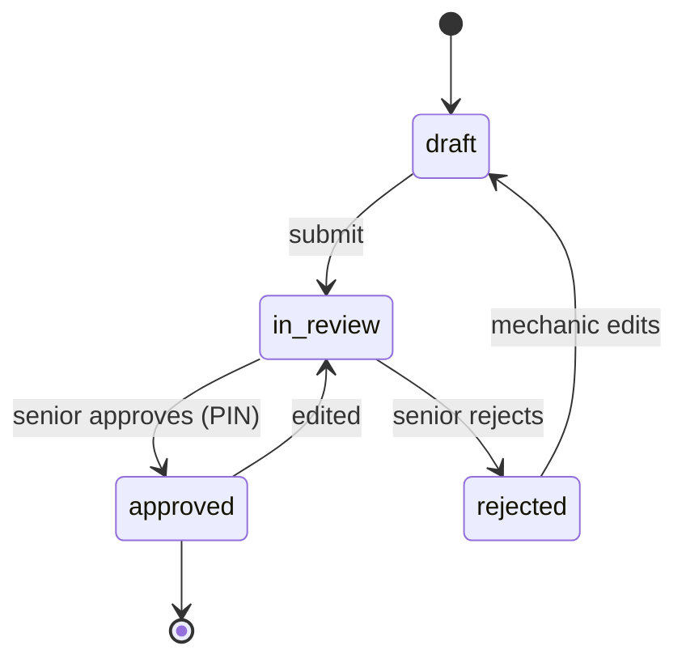
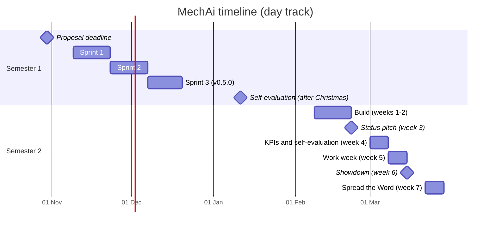

# Diagrams

Back to [Design and prototypes](Design%20and%20prototypes.md) · Decision: [ADR-34 The HTML prototype is the official design; diagrams as Mermaid in the vault](../10%20Decision%20Log/ADR-34%20The%20HTML%20prototype%20is%20the%20official%20design;%20diagrams%20as%20Mermaid%20in%20the%20vault.md)

All analysis diagrams live here as **Mermaid** code. Mermaid draws a diagram from a few lines of text, and both Obsidian and GitHub show it as a picture. Because the diagrams are text, they stay in sync with the decisions and can be reviewed in a pull request. The entity-relationship diagram is in [Data model](../03%20Architecture/Data%20model.md).

## 1. System architecture

## 2. Modules inside the backend

Arrows mean "calls the `service.py` of". No module reads another module's tables.

## 3. Handbook ingestion

## 4. Answering a question

## 5. Sign-in

## 6. Operator to mechanic flow (the December demo)

## 7. Kart status (Supercube's four values)

The exact transitions follow Supercube's system; this diagram shows how MechAi uses them. **To confirm** with Supercube.

## 8. Issue

## 9. Repair note (semester 2)

## 10. Timeline

The dates after Christmas are placeholders until the school publishes the calendar ([Planning & Deadlines](../01%20Project/Planning%20&%20Deadlines.md)).
